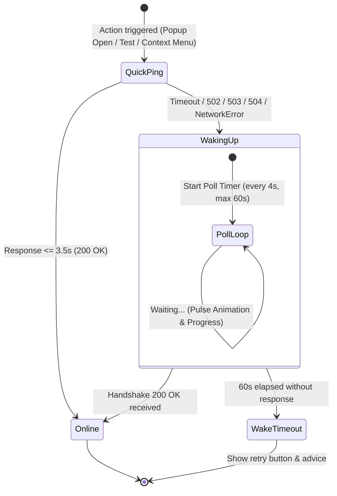

# mediaIndex Chrome Extension: Settings & Architecture Overhaul Plan

**Document:** `extension_config_plan.md`  
**Role:** Expert Chrome Extension Developer & System Architect  
**Status:** Architecture Proposal & Implementation Plan (Awaiting Review & Approval)

---

## 1. Executive Summary & Architectural Analysis

The goal of this overhaul is to transform the configuration and connection model of the **mediaIndex** Chrome Extension from a manual, error-prone setup (typing backend URLs and usernames) into an intelligent, zero-configuration companion.

### Core Objectives
1. **Smart Environment Routing & "Dev Mode" Switch**:
   - Default out-of-the-box backend is the production Render instance: `https://media-index.onrender.com/`.
   - Provide a clean "Enable Developer Mode" toggle in settings. When toggled **ON**, reveal an input to customize the local development URL (defaulting to `http://127.0.0.1:5000`). When toggled **OFF**, immediately revert to production.
2. **Graceful Handling of Render Cold Starts**:
   - Render free-tier web services spin down after 15 minutes of inactivity. Cold boots take ~30–50 seconds.
   - The extension must eliminate premature timeouts, replace "Server Offline" errors with a reassuring "Waking up server..." progress state, and implement an automated polling engine.
3. **Zero-Type User Authentication / Identity Extraction**:
   - The web application already stores user identification in browser storage (`localStorage.getItem('mua_user_id')`).
   - The extension should automatically extract and synchronize this identity whenever the web dashboard is open or visited, eliminating manual typing entirely.
4. **Codebase Cleanup & Deprecation**:
   - Remove obsolete manual namespace selects, manual URL inputs from default views, dead event handlers, and redundant ping utilities.

---

## 2. Deep-Dive Proposals

### Proposal A: Zero-Type User Authentication Architecture

#### Evaluation of Retrieval Mechanisms
| Approach | Mechanism | Security & Privacy | Reliability & UX | Verdict |
| :--- | :--- | :--- | :--- | :--- |
| **Option 1: Manual Input (Current)** | User types/selects namespace in extension. | Low security risk, but error-prone. | High friction; desync between web dashboard and extension. | ❌ **Deprecate** |
| **Option 2: Cross-Origin Cookie / Session Handshake** | Extension calls an auth API endpoint with cookies. | High security; requires backend session management. | Not applicable yet since authentication is client-side (`localStorage`). | ⏸️ **Future Phase** |
| **Option 3: Content Script Shared LocalStorage Bridge** | `content.js` matches web app domains and reads `window.localStorage`. | Safe when scoped strictly to web app origin. | Fast; reads directly from DOM/storage on dashboard load. | ⚠️ **Good, but passive** |
| **Option 4: Dual-Channel Real-Time Sync Bridge (Recommended)** | **Targeted Content Script Sync + Storage Event Listener + Auto-Pairing Query** | **High**: Scoped strictly to matched production & dev origins. No third-party leak. | **Exceptional**: Instant sync on tab open, real-time sync if user changes identity, zero typing. | 🏆 **PROPOSED** |

#### Recommended Solution: Dual-Channel Real-Time Sync Bridge
1. **Origin-Bounded Content Script Injection**:
   In `manifest.json`, bind content script execution explicitly to the web app origins (`https://media-index.onrender.com/*` and `http://127.0.0.1:5000/*` / `http://localhost:5000/*`) as well as general media scraping on `<all_urls>`.
2. **Automatic Handshake on Dashboard Load**:
   When the user visits or refreshes the mediaIndex web dashboard, `content.js` immediately extracts `localStorage.getItem('mua_user_id') || 'default'` and dispatches:
   ```javascript
   chrome.runtime.sendMessage({
     action: 'SYNC_USER_IDENTITY',
     userId: detectedUserId,
     origin: window.location.origin
   });
   ```
3. **Live Storage Event Listener**:
   In `content.js`, listen for changes on `window.addEventListener('storage', ...)` and custom events `media-index-auth-change`. If the user switches accounts in the web app, the extension updates its active user identity in real-time.
4. **Fallback & Graceful Default**:
   If the user has never opened the web dashboard, the extension defaults safely to `'default'` (the standard system namespace). The UI shows:  
   `Active User: default` with a badge `Synced with Web App ✓`.

---

### Proposal B: Render Cold-Start Delay Handling Engine

Render's free tier spins down idle containers. When a request arrives, the server takes between 30 and 50 seconds to boot, during which HTTP requests hang or return 502/503/504 Bad Gateway.

#### State Machine Design


#### Key Implementation Details
1. **Adaptive Timeout Logic**:
   - Initial quick check has a 3.5-second timeout.
   - If quick check succeeds, UI immediately displays `Online` with latency.
   - If quick check fails or times out, check if the active backend is the Render production domain (`media-index.onrender.com`).
   - If Render is detected, transition UI into `Waking Up` state:
     - Badge turns amber/yellow: `Waking up server (~30-50s)...`
     - Displays an animated spinning pulse / progress bar.
     - Starts an exponential/interval polling loop (pinging `/api/handshake` every 4 seconds for up to 60 seconds).
2. **Context Menu Background Queueing**:
   - If user right-clicks an image and selects "Send to media index" while the server is cold:
     - The background service worker detects the cold start.
     - Shows a Chrome notification:  
       `"media index — Waking up server"`  
       `"Cloud server is spinning up. Your media item has been queued and will be saved automatically."`
     - Badge flashes `'⏳'` or `'...'`.
     - Background retries until the server responds, sends the payload, and displays a success notification: `"Saved! Server is now awake."`
3. **Proactive Pre-Warming**:
   - In `popup.js`, immediately ping the server upon popup launch so the wake-up sequence starts before the user even finishes selecting images.

---

### Proposal C: Smart Environment Routing & "Dev Mode" Toggle

#### Settings Architecture
- **Production URL**: `https://media-index.onrender.com` (Hardcoded default in `config.js`).
- **Dev URL**: `http://127.0.0.1:5000` (User-configurable, stored in `devApiUrl`).
- **Dev Mode Toggle**: `devModeEnabled` (boolean in `chrome.storage.local`).

#### Storage Schema
```json
{
  "devModeEnabled": false,
  "devApiUrl": "http://127.0.0.1:5000",
  "userId": "default"
}
```

#### Environment Resolution Helper (`config.js` / runtime)
```javascript
function getActiveApiUrl(storedConfig) {
  if (storedConfig.devModeEnabled) {
    return storedConfig.devApiUrl || CONFIG.DEFAULT_DEV_API;
  }
  return CONFIG.PRODUCTION_API;
}
```

#### Settings UI Transformation
- **Default State (Dev Mode OFF)**:
  - Clean card showing:  
    `Environment: Production (Cloud)`  
    `Endpoint: https://media-index.onrender.com`  
    `Status: Online / Waking up...`
  - A single toggle switch: `[ Enable Developer Mode ] (OFF)`
  - URL text input is hidden.
- **Developer Mode State (Dev Mode ON)**:
  - Toggle switch is `ON`.
  - An animated dropdown reveals:
    - Input field for Local Backend URL (pre-filled with `http://127.0.0.1:5000`).
    - Quick-port pill buttons (`:5000`, `:5001`, `:8080`).
    - Test connection button.
  - When toggled back **OFF**, it immediately switches active endpoint back to production.

---

## 3. Deprecation & Cleanup Matrix

| File | Obsolete Element / Function | Reason for Deletion | Replacement |
| :--- | :--- | :--- | :--- |
| `config.js` | `DEFAULT_API_BASE: 'http://127.0.0.1:5000'` | Localhost should not be the production default. | `PRODUCTION_API_BASE: 'https://media-index.onrender.com'` and `DEFAULT_DEV_API_BASE: 'http://127.0.0.1:5000'`. |
| `popup.html` | `#settings-user-select`, `#settings-user-custom`, `#refresh-namespaces-btn` | User typing namespace is clunky and deprecated. | Read-only Synced User Profile badge with auto-sync indicator. |
| `popup.html` | Always-visible `#settings-api-url` input | Non-dev users should not see or type backend URLs. | Sleek Dev Mode toggle card; input is revealed only when Dev Mode is active. |
| `options.html` | `#user-select`, `#user-custom`, `#refresh-namespaces-btn` | Manual user configuration removed. | Auto-synced user identification card. |
| `options.html` | Manual Backend URL input as primary input | Manual entry is error-prone. | Dev Mode toggle switch + hidden container. |
| `popup.js` | `renderNamespaceDropdown()`, `fetchNamespaces()` namespace parsing | No dropdown rendering needed. | Dedicated `syncUserIdentity()` and simplified ping diagnostics. |
| `options.js` | `renderNamespaceDropdown()`, custom namespace input listeners | No dropdown rendering needed. | Simplified Dev Mode and Synced User controllers. |
| `content.js` | Static one-time `GET_DASHBOARD_STATE` response | Passive response only when queried. | Proactive auto-sync dispatch on page load and storage event listener. |

---

## 4. Step-by-Step Implementation Plan

### Step 1: Update `config.js`
- Define `PRODUCTION_API_BASE = 'https://media-index.onrender.com'`.
- Define `DEFAULT_DEV_API_BASE = 'http://127.0.0.1:5000'`.
- Define `COLD_START_TIMEOUT_MS = 60000`, `PING_INTERVAL_MS = 4000`, and `QUICK_PING_TIMEOUT_MS = 3500`.
- Add helper method `CONFIG.resolveApiUrl(storageData)` to ensure consistent URL resolution across background, popup, and options scripts.

### Step 2: Modernize `manifest.json`
- Ensure `host_permissions` explicitly lists `https://media-index.onrender.com/*`, `http://127.0.0.1:5000/*`, and `http://localhost:5000/*`.
- Verify background and content scripts have proper permissions.

### Step 3: Enhance `content.js` for Zero-Type Identity Sync
- Add auto-detection logic on `DOMContentLoaded` or page load:
  - If current origin matches Render or local dev origin:
    - Read `localStorage.getItem('mua_user_id')`.
    - Automatically send `{ action: 'SYNC_USER_IDENTITY', userId }` to background/storage.
- Add `window.addEventListener('storage', ...)` to capture changes if user logs in or switches workspace dynamically.

### Step 4: Upgrade `background.js`
- Update `getConfig()` to resolve API URL based on `devModeEnabled`.
- Add handler for `'SYNC_USER_IDENTITY'` message to save `userId` to `chrome.storage.local`.
- Upgrade context menu submission with Render cold-start resilience:
  - If initial ping detects sleeping Render instance, notify user that server is waking up.
  - Poll `/api/handshake` for up to 60s, then proceed with submission once online.

### Step 5: Overhaul In-Popup Settings (`popup.html` & `popup.js`)
- **HTML UI (`popup.html`)**:
  - Replace manual URL input with **Developer Mode toggle switch**.
  - Add collapsible `#dev-mode-container` containing local URL input and preset buttons.
  - Replace `#settings-user-select` with a sleek `#synced-user-card` showing current user and sync badge.
  - Add a **Render Cold Start notification banner** in `#scanner-view` and `#settings-view`.
- **Controller Logic (`popup.js`)**:
  - Strip obsolete namespace dropdown and manual custom input functions.
  - Wire Dev Mode toggle switch:
    - Toggle ON: show `#dev-mode-container`, set `devModeEnabled: true`.
    - Toggle OFF: hide container, set `devModeEnabled: false`, immediately switch to production.
  - Implement cold-start polling engine with visual countdown / pulse indicator.
  - Connect auto-detected user profile display.

### Step 6: Overhaul Extension Options Page (`options.html` & `options.js`)
- Match the new architectural pattern in `options.html` and `options.js`:
  - Dev Mode toggle switch with conditional input field.
  - Synced User Identification status display.
  - Live cold-start ping and diagnostics.
  - Remove deleted elements and listeners.

### Step 7: Update Web Application Dashboard (`static/js/app.js` & `app.py` if needed)
- Ensure `app.js` dispatches custom event or updates `localStorage['mua_user_id']` clearly when loaded.
- Ensure `/api/handshake` in `app.py` returns healthy JSON with `app: 'media-index'`.

---

## 5. Verification & Testing Matrix

| Scenario | Expected Result |
| :--- | :--- |
| **Fresh Install / Default State** | Extension defaults to `https://media-index.onrender.com` without prompting user for URL. |
| **Render Cold Start** | Popup displays "Waking up server..." with pulse animation; polls every 4s; smoothly flips to "Online" once awake without user manual refresh. |
| **Enable Developer Mode** | User flips toggle ON in settings; input reveals with `http://127.0.0.1:5000`; test ping connects to local Flask server. |
| **Disable Developer Mode** | User flips toggle OFF; settings immediately reverts to production URL; dev input disappears. |
| **Zero-Type Auth Extraction** | When user opens dashboard in any tab, extension content script automatically syncs `mua_user_id` to storage. Popup shows matching user without typing. |
| **Context Menu Cold Start** | Right-clicking an image while Render sleeps triggers "Waking up cloud server... Ingestion queued" notification; succeeds automatically when awake. |
| **Regression Check** | Media scanner on normal web pages continues to capture images, videos, GIFs, and send batch imports cleanly. |

---

> [!IMPORTANT]
> **STOP AND WAIT:** Per workflow rules, no HTML, CSS, JS, or Python code will be modified until you review this plan, suggest any refinements, and give your explicit approval.

